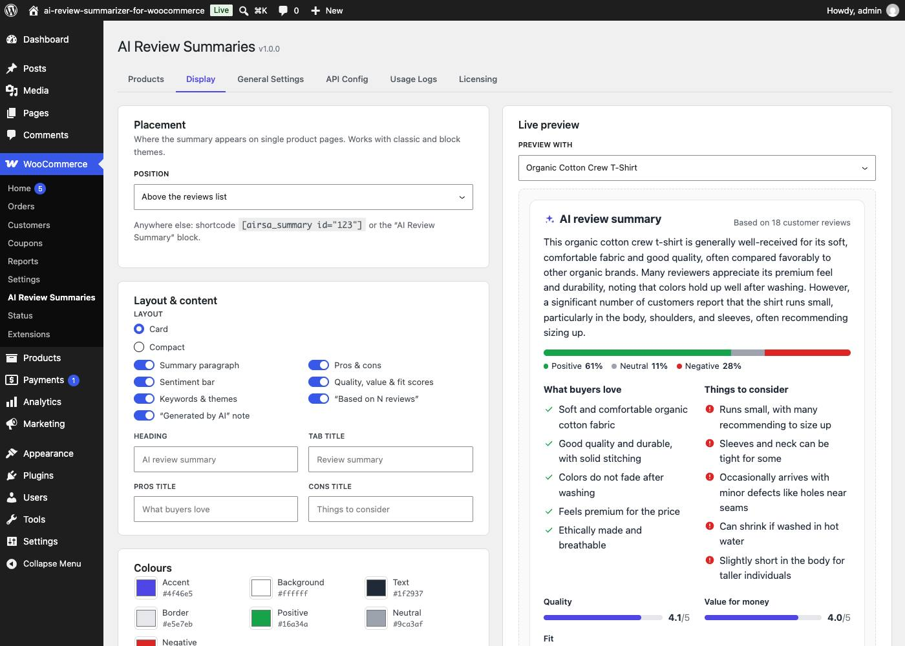

# DEV3 AI Review Summarizer & Sentiment Analyzer for WooCommerce

AI review summaries with pros & cons, sentiment and quality, value and sizing scores on WooCommerce product pages.



## Features

Shoppers don't read 40 reviews. DEV3 AI Review Summarizer reads them for them, and shows a clean, accessible summary on every product page.

**What the summary shows**

* **What buyers love / Things to consider**: short, concrete pros and cons that come up again and again.
* **One-paragraph summary**: a neutral overview written for shoppers.
* **Sentiment bar**: share of positive, neutral and negative reviews.
* **Scores**: quality and value for money (1–5), plus a fit scale (runs small, true to size, runs large) for clothing and shoes. Scores that reviewers don't discuss are hidden.
* **Keywords & themes**: recurring topics tagged positive, neutral, negative or mixed.

**Built for store owners**

* **Automatic updates**: new, approved, edited or removed reviews queue a background update (Action Scheduler, bundled with WooCommerce, with a WP-Cron fallback). Reviews arriving close together are summarised in one request.
* **No wasted API calls**: summaries are cached in product meta together with a fingerprint of the review set. Nothing is sent again until the reviews change.
* **Nightly refresh** of stale and missing summaries, and **bulk "Generate missing" / "Refresh stale"** with a live progress bar.
* **Moderation**: view, edit and **lock** any summary. Locked summaries are never overwritten automatically.
* **Prompt-injection safe**: reviews are treated as untrusted data. A review that tries to instruct the AI ("ignore all previous instructions…") is ignored and flagged for moderators, and links are stripped from the output.
* **Minimum review threshold**: products with too few reviews show nothing.
* **Summary language**: your store language, or the language most reviews are written in.

**Display anywhere**

* Auto-insert **above the reviews list**, **below the Add to cart button**, in its own **"Review summary" tab**, or turn it off.
* `[dev3rs_summary id="123"]` shortcode and an **AI Review Summary** block (dynamic, works in the Site Editor's single product template).
* Card or compact layout, your colours, corner radius, custom headings, and toggles for each section, with a live preview.
* Works with classic and block themes. Server-rendered, accessible markup, about 6 KB of CSS, no jQuery and no JavaScript on the storefront.
* Renders nothing when a product has no summary. It never prints fake schema.org ratings.

Compatible with WooCommerce High-Performance Order Storage (HPOS) and the block-based Cart & Checkout.

## Requirements

- WordPress 6.0 or newer (tested up to 6.8)
- PHP 7.4 or newer
- WooCommerce 7.0 or newer (required)
- Optional: your own Google AI API key (from Google AI Studio) to switch on the DEV3 AI features. The rest of the plugin works without one.

## Installation

### From the release zip

1. Download `dev3-ai-review-summarizer-for-woocommerce.zip` from the [latest release](https://github.com/dev3tech/dev3-ai-review-summarizer-for-woocommerce/releases/latest).
2. In WordPress, go to **Plugins → Add New → Upload Plugin**, choose the zip and click **Install Now**.
3. Click **Activate**.

### Build from source

```bash
git clone https://github.com/dev3tech/dev3-ai-review-summarizer-for-woocommerce.git
cd dev3-ai-review-summarizer-for-woocommerce
composer install --no-dev
npm ci
npm run build
```

Then copy the `dev3-ai-review-summarizer-for-woocommerce` folder into `wp-content/plugins/` and activate it.

### Getting started

1. Install and activate WooCommerce.
2. Upload `dev3-ai-review-summarizer-for-woocommerce.zip` in Plugins → Add New → Upload Plugin, then activate it.
3. Create an API key at https://aistudio.google.com/app/apikey.
4. Go to WooCommerce → DEV3 AI Review Summaries → API Config, paste the key and click "Validate & save".
5. On the Products tab, click "Generate missing" to summarise every product that has enough reviews.

## FAQ

### Which AI does it use?
The summaries are powered by the Google AI API, using your own API key.

### How much does it cost to run?
One request per product each time its reviews change, typically 1,500–2,500 tokens. Google AI Studio keys include a free tier; heavier use needs billing on your Google Cloud project. Usage Logs shows every request.

### Can I correct a summary?
Yes. Open View / Edit on the Products tab, change any field and click "Save & lock". Locked summaries are never replaced automatically; "Regenerate" asks before it unlocks one.

### Who can manage summaries?
Users with `manage_woocommerce` (shop managers and administrators) can generate, edit and lock summaries. Only administrators (`manage_options`) change settings. Both can be changed with the `dev3rs_capability` and `dev3rs_manage_capability` filters.

### Does it add star ratings to Google results?
No. The plugin never outputs structured data for its summary. WooCommerce's own review markup is untouched.

## Privacy

This plugin sends product review data to a third-party service, the **Google AI API** (generativelanguage.googleapis.com, operated by Google), to generate summaries.

* **What is sent:** the product name and category, and for each approved review its text, star rating, month and whether it is from a verified owner.
* **What is never sent:** reviewer names, email addresses, IP addresses, user agents or account details. Email addresses, phone numbers and links inside review text are redacted before sending.
* **When:** only when a summary is generated: automatically after review changes (if enabled), during the nightly refresh (if enabled), or when an admin clicks Generate/Regenerate.
* The key is encrypted in your database (AES-256-GCM) and never sent to the browser.
* **Stored data:** summaries are stored in product meta (`_dev3rs_summary`, `_dev3rs_locked`); usage logs (task, model, tokens, user ID) in the `dev3rs_usage` table. Enable "Delete all plugin data when uninstalling" to remove everything.

Consider mentioning AI-generated review summaries in your store's privacy policy.

## Documentation

The full HTML guide (installation, settings, hooks and FAQ) is in [`docs/index.html`](docs/index.html). Open it in a browser after cloning or downloading the repository.

## Changelog

### 1.0.0
* Initial release.

## Licence

Released under the GNU General Public License v2.0 or later (GPL-2.0-or-later). See [LICENSE](LICENSE).

## More from DEV3

- [DEV3 AI Review Summarizer & Sentiment Analyzer for WooCommerce on the DEV3 Marketplace](https://www.dev3.tech/item/dev3-ai-review-summarizer-for-woocommerce)
- [More WordPress plugins, themes and templates from DEV3](https://www.dev3.tech/marketplace)
